# A7 – FEA on Bracket (and Link)

## Objective
The objective of this assignment involves the repeated use of a finite element analysis to fine-tune elements and dimensions through three attempts to get a mesh converge difference of 7% or less on both the bracket and link (2157 only). I will keep my chosen material of ATSM A36 steel, and I completed this on Creo Parametric. 

## Initial Design
1. For the first run of each analysis type, I decided to leave the bracket as-is, and change nothing to get a baseline of the original values for the bracket when I calculated the values. For the Stress analysis, I added a downward force on the cylindrical beam at the bottom of 20lbf, and a constraint on the top of the inside of the bracket, as it would normally rest on another piece there. I had a safety factor of 1.54, mass of 2.1069012e-03 LBF SEC^2 / IN, max stress of 23325 PSI as the very beginning of the top part of the cylindrical beam by the cantilever section, and a max deformation of 0.0178 inches. the results are below:
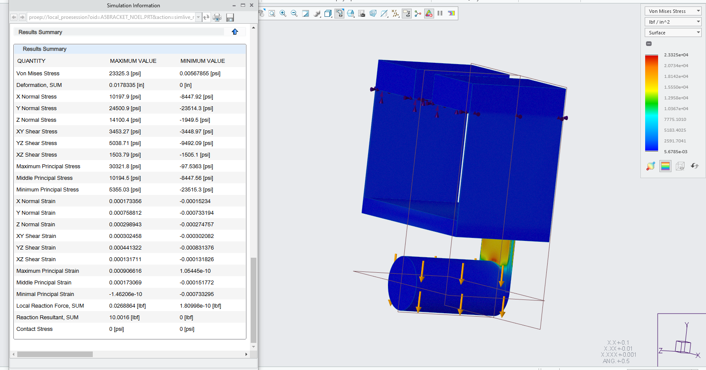
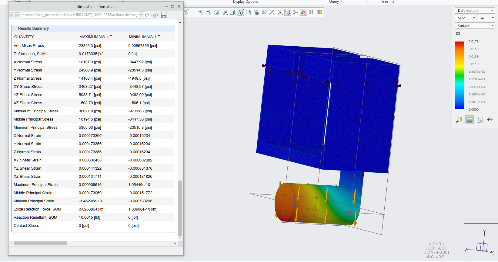
3. For the next design, I saw that the thickness of the cantilever beam section, connecting the cylindrical beam and top half of the bracket was 0.0745 inches thick, and had some decent stress on it when a 20lb load was applied. I decided to decrease it to 0.070 inches to see how much of a difference it made. The mass changed to 2.1056042e-03 LBF SEC^2 / IN, the max stress was 26415.1 PSI, the max deformation was 0.0212 inches, and the safety factor was 1.36. the mesh convergence I got was 13%. I still must tweak the next design even more. Below are the results:
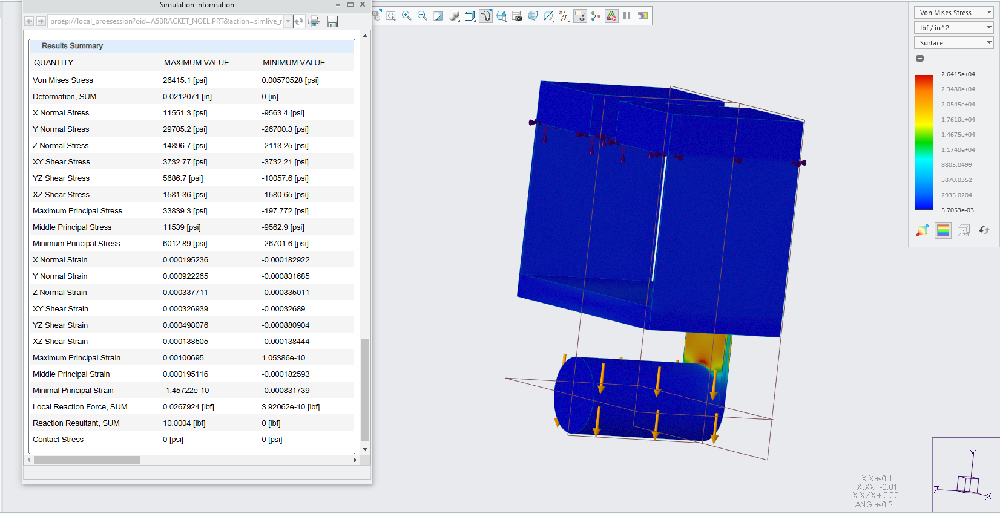
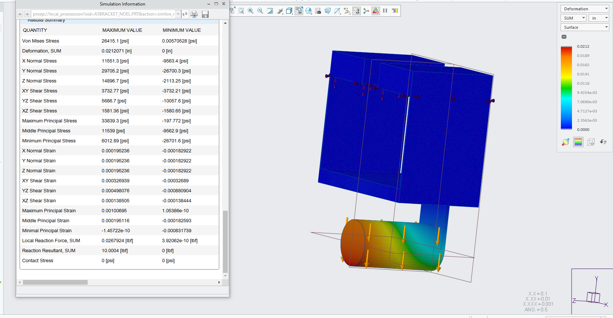
4. For my third design, I decided to try and shorten the length of the cylindrical beam to reduce the amount of material used in the bracket, specifically from 1.5 inches to around 1.4 inches, in addition to the modified thickness of the second design. With this third design, the new max stress was 23291.5 PSI, max deformation was 0.0187 inches, safety factor of 1.54, and a mass of 2.0730750e-03 LBF SEC^2 / IN. This achieved a mesh convergence of 0.1%! I was surprised to see such a number, but it is well below the exact 7% mark I was supposed to hit. I find it hilarious that on both attempts, I am nowhere any closer to the 7% compared to the last. Below are the results:
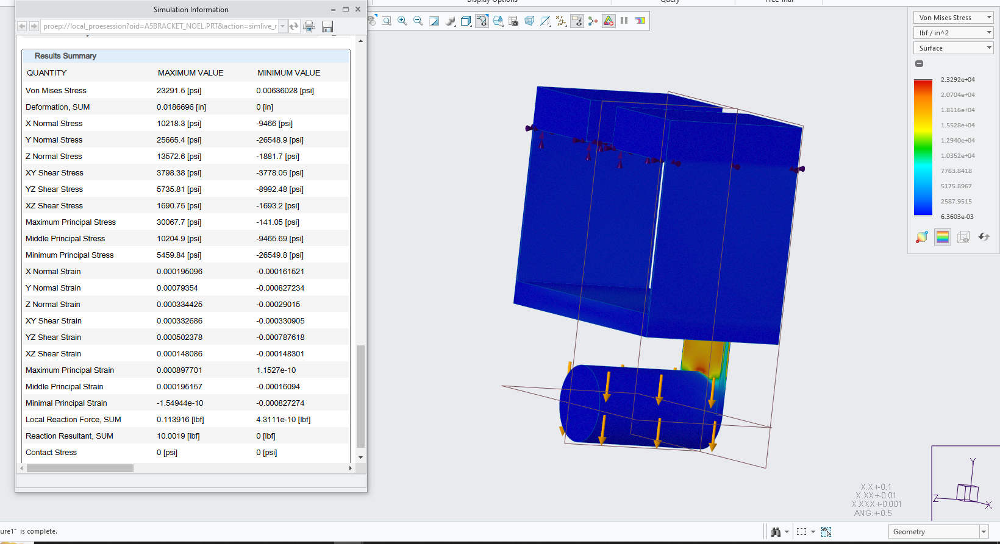
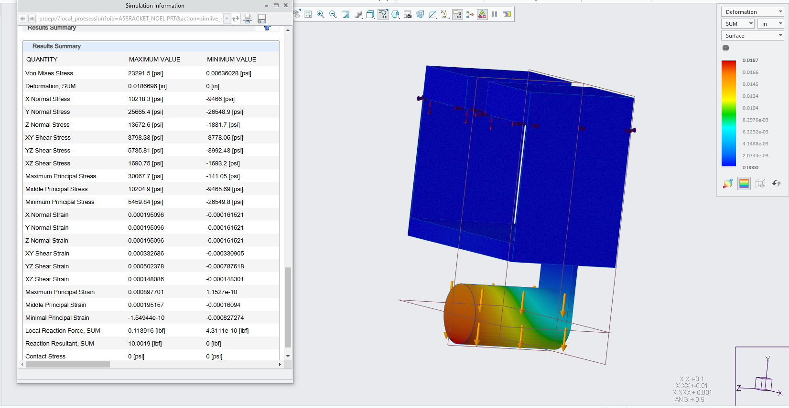

## 2157 Link Design
1. For the first run of the link's design, I did not change anything to get a guage of what numbers I must base my changes off of. The initial max stress is 0.4127 PSI, the max deformation is 1.8676e-08 inches, mass of 4.6708725e-04 LBF SEC^2 / IN, and safety factor of an insane 87230.43, which seems quite insane. Below are the results:
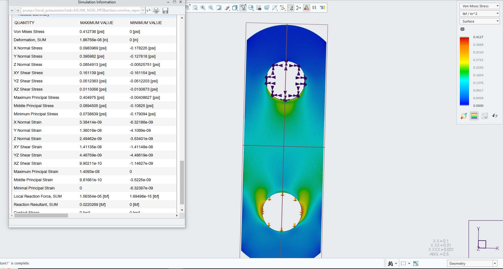
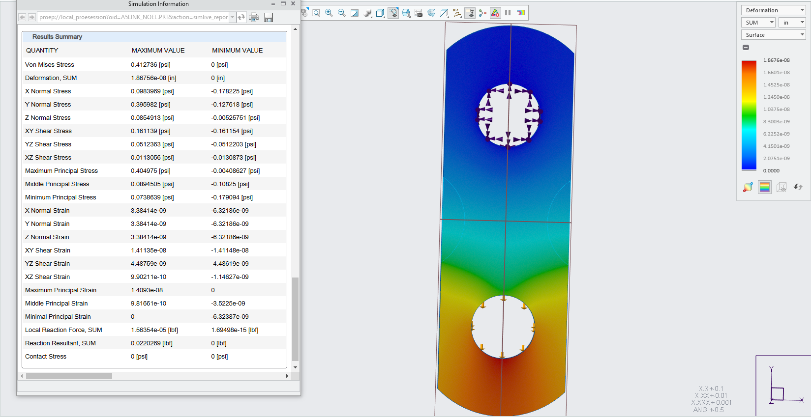
3. For the second run of the link's design, I decided to take some of the middle material on the sides of the link out of the link, to decrease overall weight and material usage in the product. This gave a max stress of 0.4679 PSI, max deformation of 2.244e-08 inches, a mass of 4.3720780e-04 LBF SEC^2 / IN, and a safety factor of 76939, which is ever so closer to a 1 than the previous SF was. This led to a mesh convergence of 13%, which seems alright for the amount of material I took out of the product. Below are the results:
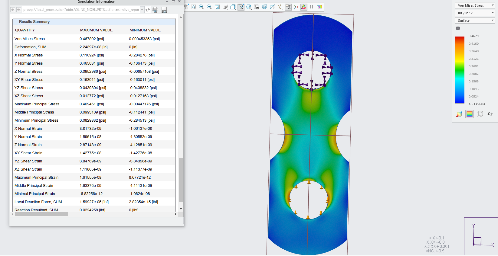
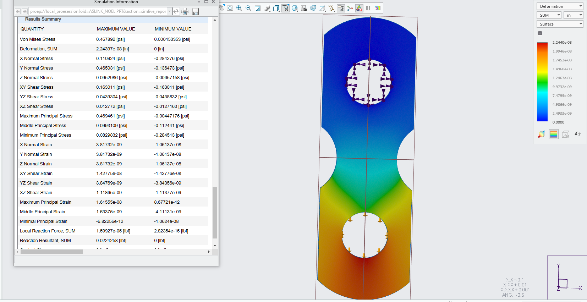
3, For the third run of the link's design, I took away the chunks of removed materials, and added two holes inside the middle of the link. This led to a new mass of 4.1920000e-04 LBF SEC^2 / IN, max stress of 0.5092 PSI, max deformation of 2.4139e-08 inches, and safety factor of 18331, which is a few magnitudes closer to 1 than the previous 2 designs. This led to me calculating a mesh convergence of 23%, which is even further than the last one from 7%. Below are the results:
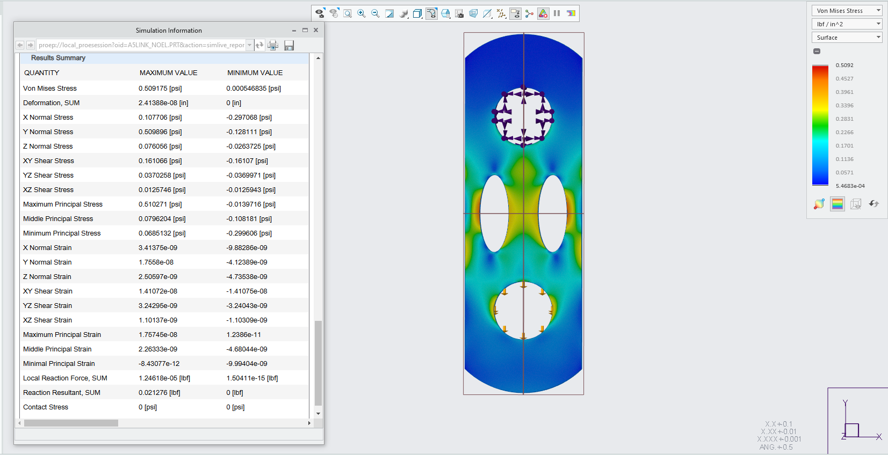
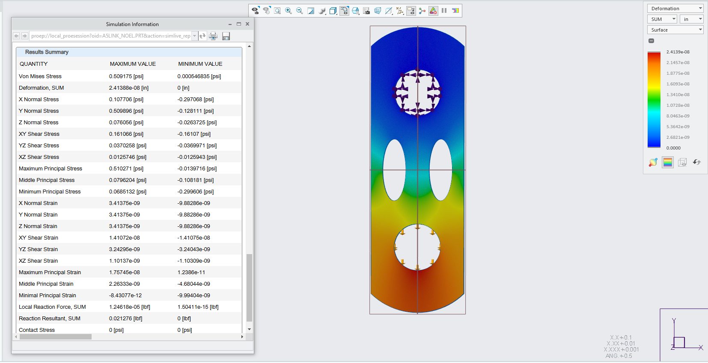

## Communicate
Overall, this assignment was a very engaging spin on finite element analyses. Having to change specific designs without any guidance to see for ourselves how to get a specific mesh convergence was quite the challenge, but also quite fun to maneuver around and figure out our own unique ways of getting closer to the value. Having to use the analysis and simulations to find out the max stress, deformation, mass, and safety factor was different depending on the software used, as my friends who used Solidworks compared to Creo, or any other software had different issues in finding their own values. I spent around 4.5 hours on this assignment, and it was one of the easier ones compared to the last 6 I've done thus far. In Creo Parametric, I could not find anything related to numbers of elements when simulating the stress and deformation analyses, so I had to forgo it in the whole assignment. Otherwise, it was smooth and pretty intuitive to finish. I learned that removing or changing the dimensions of some aspects of a part can drastically change the safety factor and max stress/deformation, and its not always for the better.

