# A8 – Gears

## Objective
Numerically calculate various dimensions of Shafts and bearings for a Gearbox to fit two specific gears given, and parametrically create said gearbox in a CAD system of your choosing, with (2157 Only) drawings of each part utilized in said CAD system.

## Numerical Analysis
To start off, I did all of my calculations to find the stress of both the inner and outer shafts, as well as the torque force of the outer shaft, while comparing the stresses to a maximum stress given to us by the Machinery's Handbook to see if the calculations are within safety standards. Next, I found the work load on the shafts, then calculated the thickness of the bearings and found the right bearing to utilize from the McMaster website to find the best fit bearing for my assembly. Below is all of my work shown and calculations.
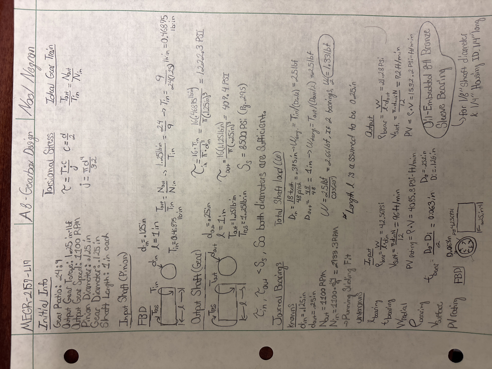

After finding this information, I was ready to choose the bearing of best fit, as stated at the bottom right of my calculation sheet. I chose the bearings shown below:
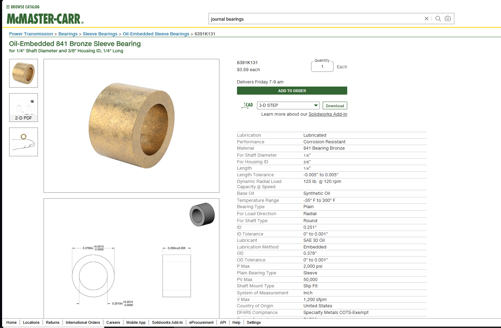
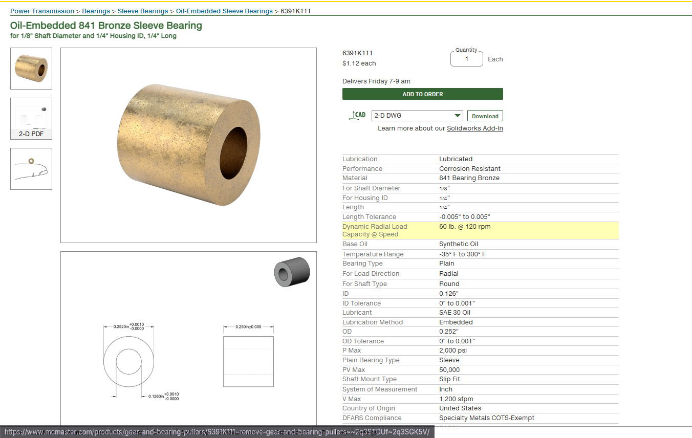

With this information and choice, I was ready to start creating my assembly in Creo Parametric. Below is my sketch of what my gearbox would look like:
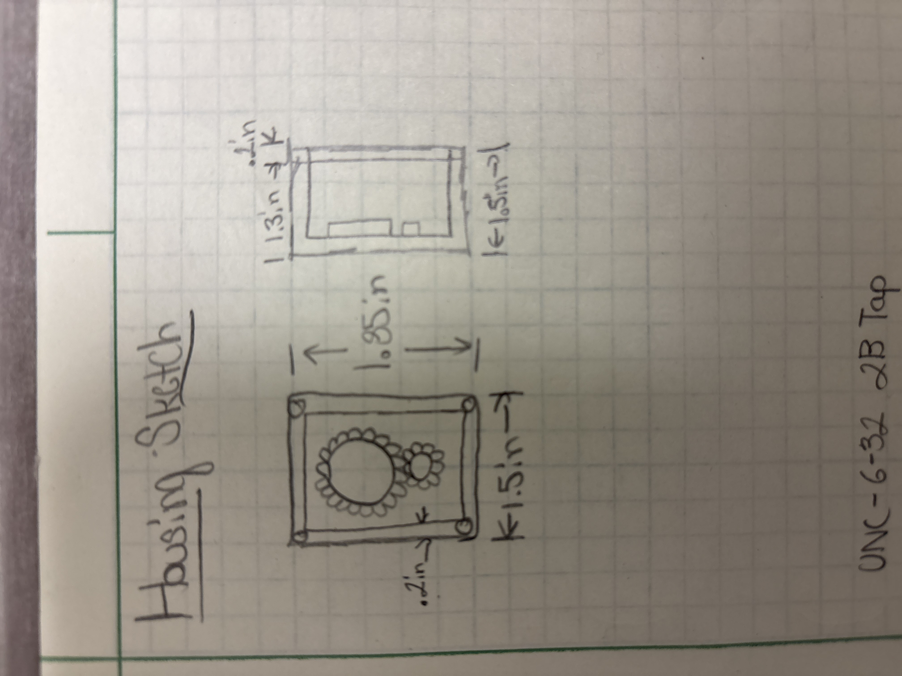

## CAD Assembly
This next part of the assignment was very intriguing. I am used to using Creo Parametric for assemblies and designs, but this time around I struggled a little with getting my parts fully constrained inside of the gearbox. Since we did not need for it to necessarily be functional, I constrained the gears and shafts to be coincident with the bottom of the box, and then constrained them to their exact positons lined up in the below photos of my finished assembly. I also added some holes for where a screw would go into, but as I ran out of time to really complete and add the screws, I just added holes to where the screws would go inside of the box, and on the lid. Below are my finished assemblies:
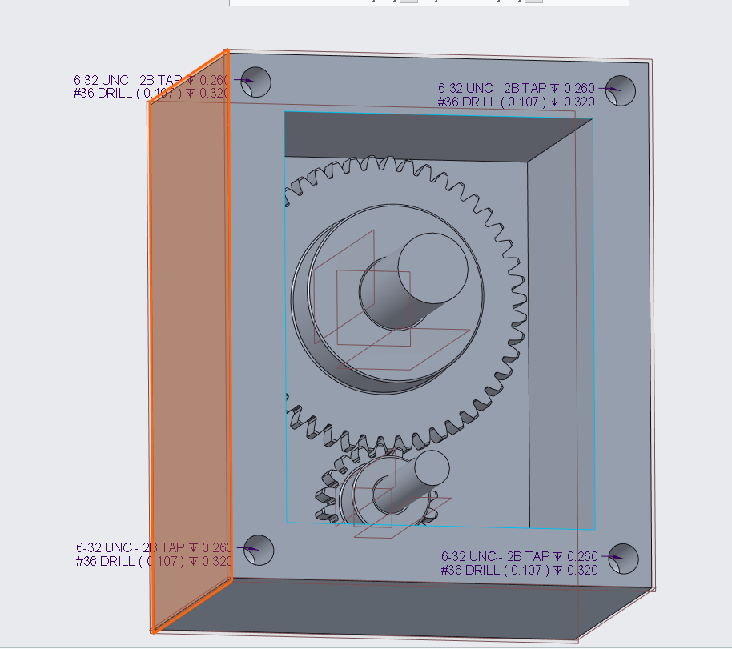
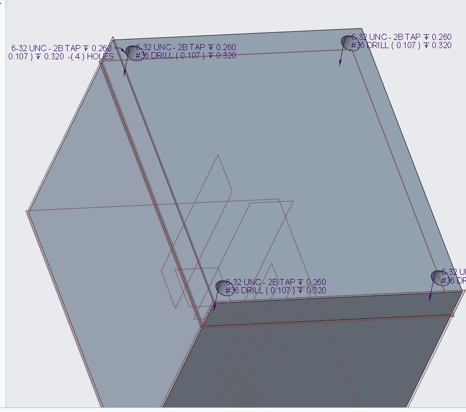

## 2157 Only - CAD Drawings
This part was pretty self explanatory; I created ASME standard drawings for each individual part I utilized in my assembly, as well as a drawing of the completed assembly. Below are my drawings:
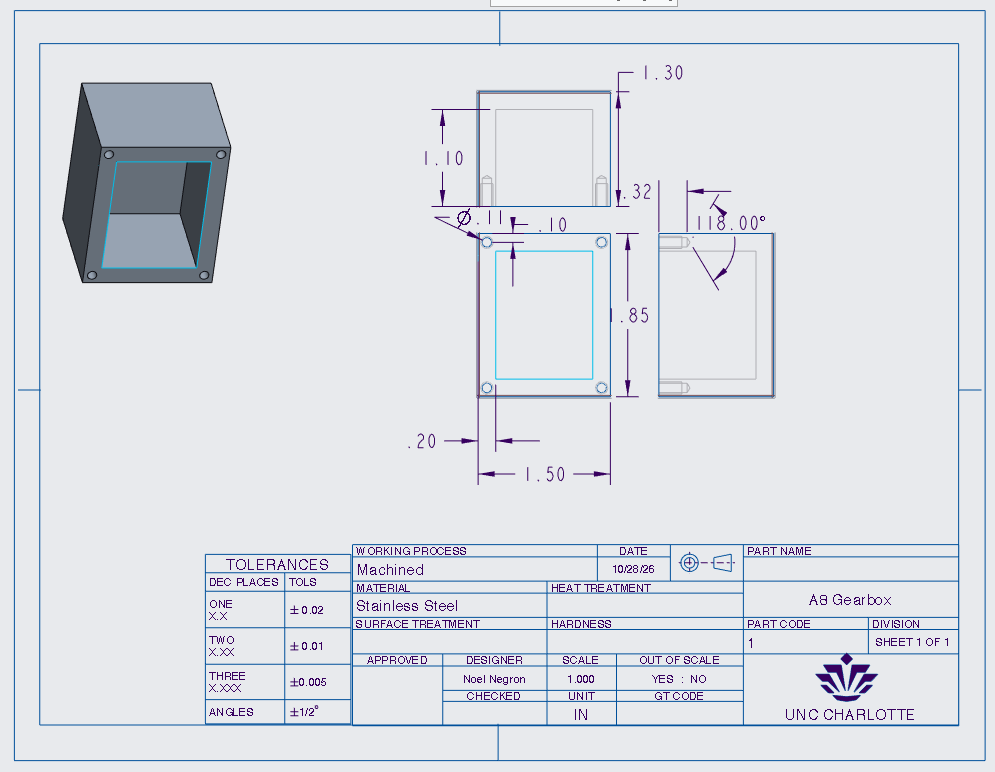
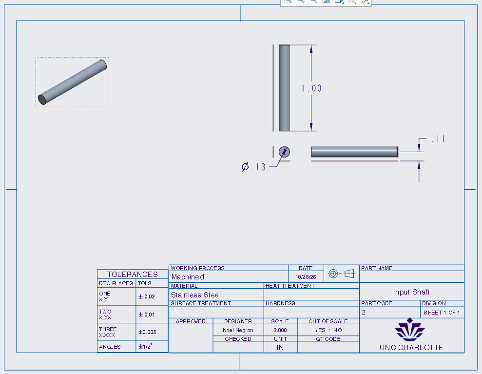
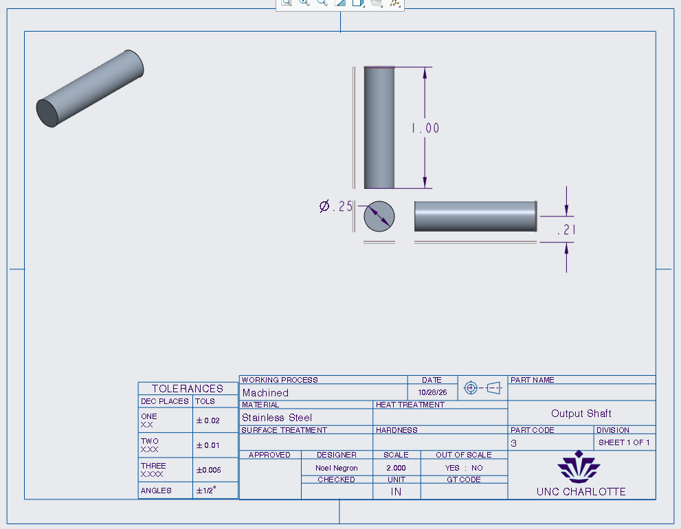
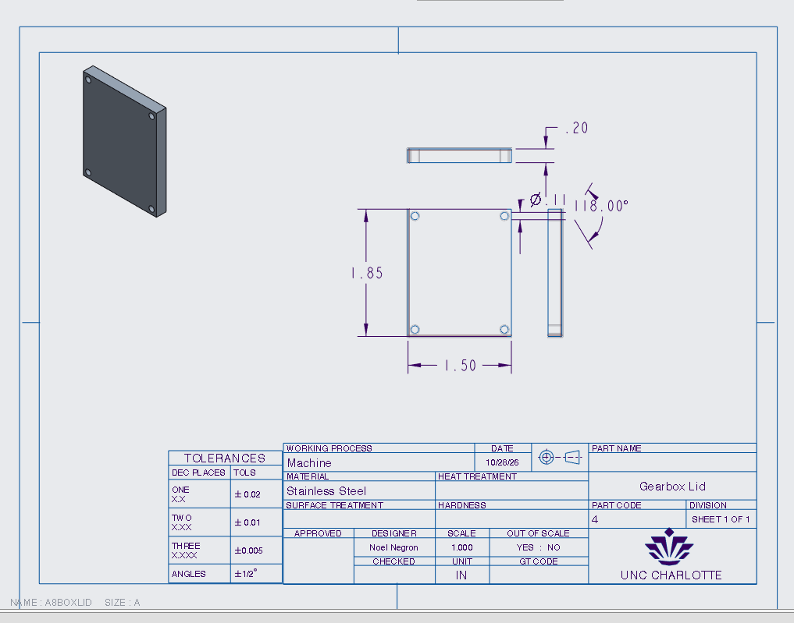
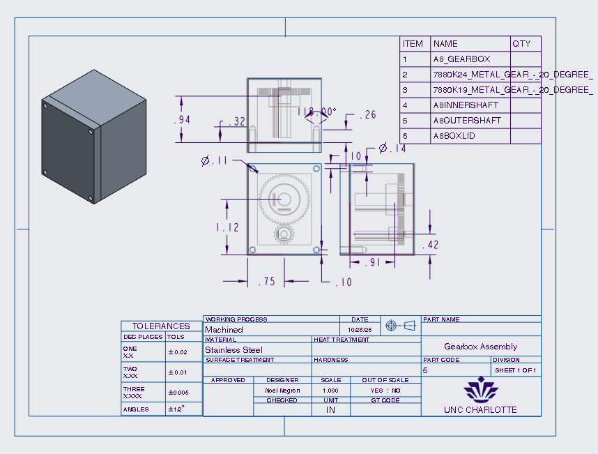

## Review
This assignment was not too difficult in terms of actual work, but the initial part of doing the calculations and finding out what variables and dimensions and factors I must find and use got pretty tricky, which took the most time and effort compared to the rest of the assingment. This took me around 4 hours to finish in its entirety, which isn't too bad compared to the other assignments I have completed thus far.

[gearbox](a8_gearbox.prt.zip)
[gearbox lid](a8boxlid.prt.zip)
[assembly](a8gearbox.asm.zip)
[inner shaft](a8innershaft.prt.zip)
[outer shaft](a8outershaft.prt.zip)
[outer shaft drawing](a8outshaft.drw.zip)
[inner shaft drawing](a8inshaft.drw.zip)
[gearbox drawing](a8box.drw.zip)
[gearbox lid drawing](a8boxlid.drw.prt.zip)
[Inner Bearing](a8_gearbox.prt.zip)
[Outer Bearing](6391k131_oil-embedded_841_bronz.prt.zip)
[Inner Gear](7880k19_metal_gear_-_20_degree_.prt.zip)
[Outer Gear](7880k24_metal_gear_-_20_degree_.prt.zip)
