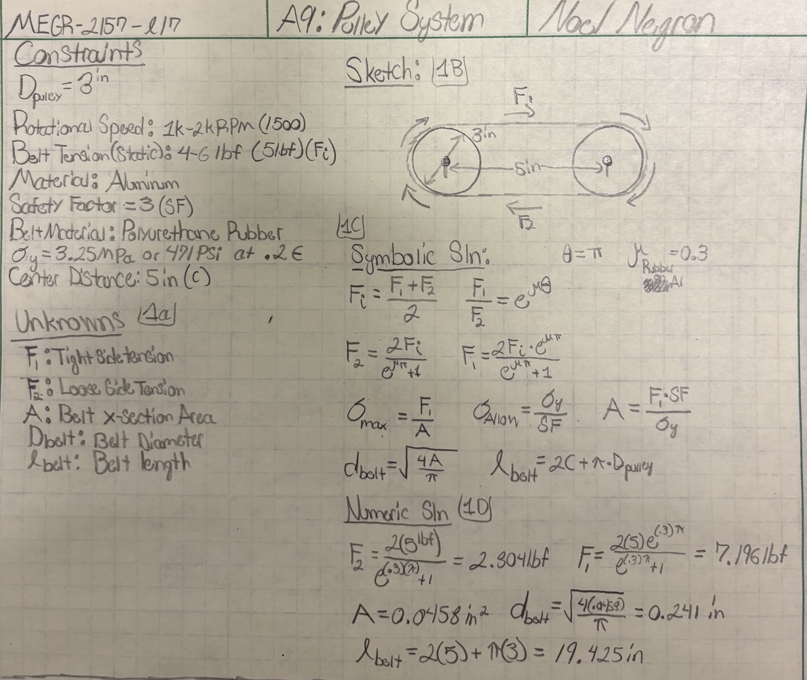
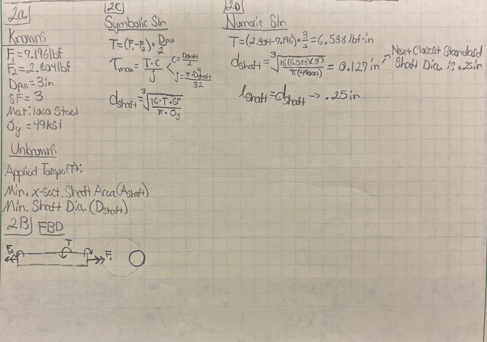
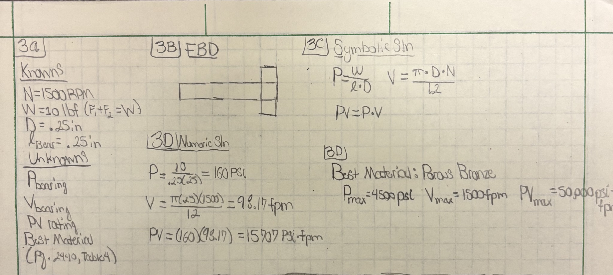
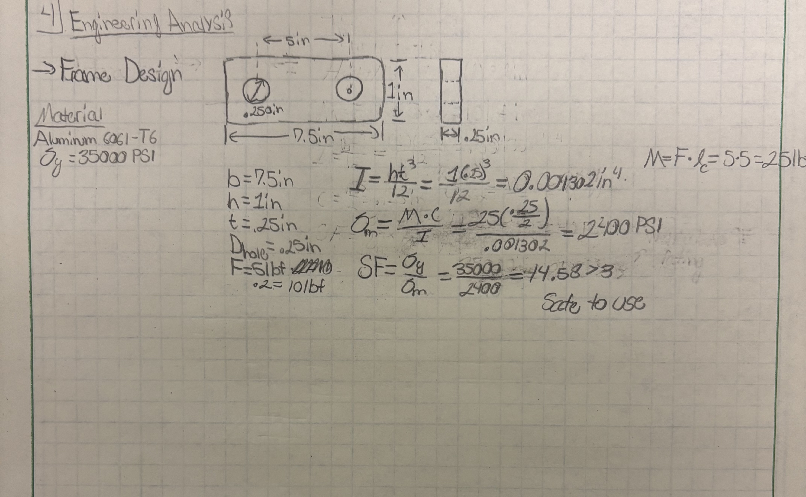

# A9 – Pulleys

## Objective
Numerically design a pulley system, including its shaft, bearings, and framing all with calculations and engineering analysis learned from previous assignments and lectures.

## Belt Calculations

Above resides my calculations for the belt I needed for my pulley system. I assumed a frictional constant of 0.3 when taking my calculations for ease of calculation.Through my calculations, I ended up with a belt length of 19.425 inches, and a diameter of 0.241 inches. With these dimensions, I could search up and locate a belt with similar dimensions to use for my pulley. The one I ended up choosing was a 19 1/2" round belt with a 1/2" diameter off of McMaster-Carr. It is relatively cheap, as it is only $8.23, and made of polyurethane. Here is the link to the exact belt: 
[McMaster-Carr 1/2" Round Belt 19 1/2" Length](https://www.mcmaster.com/products/round-belts/round-belts-2~~/outer-circumference~19-1-2/)

## Shaft Calculations

Above lies my calculations for the shaft I was required to design for my pulley system. Taking the forces from my previous belt calculations, I utilized them to come up with the length and diameter required to have a working shaft. Through my calculations, I ended up with a 0.127 inch diameter shaft, but for ease of access, I chose a standard diameter shaft size of 1/4", which is nearly double the required diameter, and is exponentially easier to come by than an exact 0.127" diameter. I also decided to go for a 1:1 L/D ratio, and make the length of the shaft to 0.25 inches.

## Bearing Calculations

Above are the calculations I derived for finding the required ratings for the bearings for my pulley system. With the values I knew already, I could calculate the pressure and velocity, which also allowed me to calculate the PV rating, which would give me all of the information I could need to find the best material for the bearing. The material I chose was porous bronze, as all three maximum ratings were well above the calculated ratings I had, which makes it very safe for use in my pulley system.

## Frame Creation

Above is the frame design and dimensions that I saw best fit for this pulley system, as well as my calculations proving that it is safe to use. The material I used was 6061-T6 aluminum. It ended up with a safety factor of 14.58, which is far enough higher than the baseline of 3, which is what I was aiming to be over. This meant that my frame is safe to use.

## Reflection
Overall, this assignment was a breath of fresh air compared to the previous assignments that involved both CAD and numerical analysis. Being able to finish it all on paper saved me a lot of time I otherwise would have spent here and not on other projects and classes I am taking. It took me around 1.5 hours to finish this assignment, which is way better than the past 6 or more for previous assignments. It was beneficial for me to utilize torque and more solids-esque techniques, as I have an exam on these topics to prepare for.

